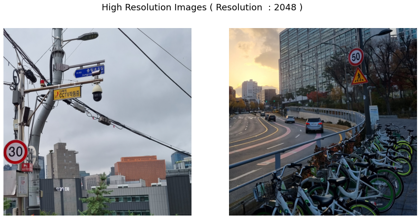

# Dacon AISR

**4× image super-resolution** for the AI Yangjae Hub Open Source Competition: reconstructing 2048 × 2048 images from 512 × 512 inputs.

[Demo](https://colab.research.google.com/drive/1YsQYNFk4HY_INYjtruLWCcbiZFPJgCP6?usp=sharing) · [Project report](Dacon_AISR_final6.pdf) · [Setup and inference](docs/competition-setup.md) · [Competition](https://dacon.io/competitions/official/235977/overview/description)

| Recorded result | PSNR score | Rank |
| --- | ---: | ---: |
| Private leaderboard | **25.00327** | **1st** |
| Public leaderboard | 25.96657 | 2nd |



*Saved 4× outputs from the [demo notebook](Dacon_AISR_Demo_Description.ipynb). Scores and images are the repository's recorded competition results.*

## Approach

- **RRDBNet reconstruction:** a 23-block network with 64 feature channels and 4× upsampling.
- **Paired training:** low/high-resolution image pairs, rotation and flip augmentation, and 512-pixel ground-truth crops.
- **PSNR-oriented optimization:** MSE loss, Adam, exponential moving-average weights, and a multistep learning-rate schedule.
- **Geometric self-ensemble:** eight rotated/flipped views are restored, transformed back, and averaged in `RRDBNetRot`.

The [training configuration](options/finetune_realesrnet_x4plus_pairdata.yml) and [inference architecture](realesrgan/archs/rrdbnetrot_arch.py) contain the implementation details.

## Try the model

Use the [Colab demo](https://colab.research.google.com/drive/1YsQYNFk4HY_INYjtruLWCcbiZFPJgCP6?usp=sharing), or follow the [local setup guide](docs/competition-setup.md) to install the original dependencies and obtain the competition checkpoint. With `weights/net_g_905000.pth` in place, run:

```bash
python inference_rrdbnetrot.py \
    --model_path=./weights/net_g_905000.pth \
    --input=./inputs/test/lr \
    --output=./results \
    --suffix=''
```

The guide also includes input/output previews, the dataset layout, and fine-tuning instructions.

## Team and acknowledgments

**모두연 포레버** · **박수철 (Soochul Park)**, 장진우, 윤성국, 양성모.

Built on [Real-ESRGAN](https://github.com/xinntao/Real-ESRGAN) and [BasicSR](https://github.com/XPixelGroup/BasicSR). The [upstream README](resrgan_readme.md) and [BSD 3-Clause license](LICENSE), including the original copyright attribution, are retained.
