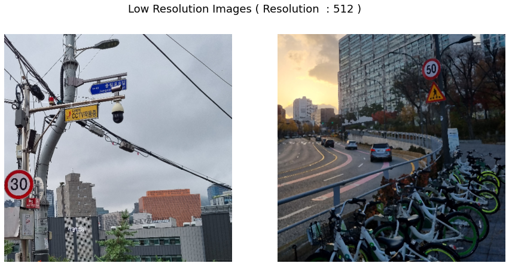
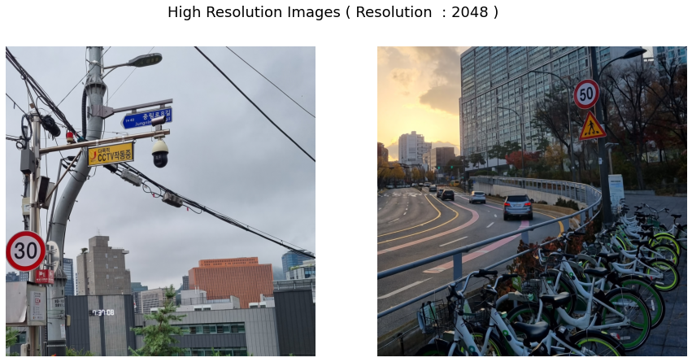

# Setup and inference

[← Back to Dacon AISR](../README.md)

## Original environment

The competition work used Ubuntu 20.04.5 LTS, an Intel Xeon Gold 6230R CPU, four NVIDIA A5000 GPUs, and Colab Pro+ as a secondary environment. This describes the recorded training environment, not a minimum inference requirement.

## Installation

```bash
git clone https://github.com/Jinwoo1126/Dacon_SR.git
cd Dacon_SR
pip install -r requirements.txt
python setup.py develop
```

The requirements include BasicSR, facexlib, GFPGAN, PyTorch, and torchvision. They are the original dependency declarations and do not provide a fully pinned, currently validated environment.

## Checkpoint and data

Download the original [RRDBNet ×4 checkpoint](https://drive.google.com/file/d/1piw_MOIE5bTH3-o9rmWqp3uIZoYcc5Wl/view?usp=sharing) and place it at `weights/net_g_905000.pth`. The checkpoint is not bundled in the repository.

```text
Dacon_SR/
├── weights/
│   └── net_g_905000.pth
├── inputs/
│   ├── test/lr/       # input images for inference
│   └── train/
│       ├── lr/       # paired low-resolution training images
│       └── hr/       # corresponding high-resolution targets
└── results/          # created by inference
```

## Inference

From the repository root:

```bash
python inference_rrdbnetrot.py \
    --model_path=./weights/net_g_905000.pth \
    --input=./inputs/test/lr \
    --output=./results \
    --suffix=''
```

Inference uses `RRDBNetRot`, which averages eight transformed predictions. Outputs are written to `results/`. The script supports a single input image or a folder, optional tiling through `--tile`, and full-precision inference through `--fp32`.

### Saved example

The figures below are extracted unchanged from [the original demo notebook](../Dacon_AISR_Demo_Description.ipynb). They are displayed at a common width; open an image to inspect the saved figure.

**Input · 512 × 512 source images**



**Output · 2048 × 2048 reconstructed images**



## Optional fine-tuning

Prepare paired data under `inputs/train/lr` and `inputs/train/hr`, then review [the configuration](../options/finetune_realesrnet_x4plus_pairdata.yml), including the checkpoint path and GPU selection. Its `total_iter` value is `999999999`; set an intentional training budget before starting a new run.

```bash
python realesrgan/train.py -opt options/finetune_realesrnet_x4plus_pairdata.yml
```

| Setting | Recorded configuration |
| --- | --- |
| Scale / GT crop size | 4 / 512 |
| RRDB blocks / features / growth | 23 / 64 / 32 |
| Optimizer | Adam, learning rate `1e-4`, betas `(0.9, 0.99)` |
| Loss | MSE, mean reduction |
| EMA decay | `0.999` |
| LR schedule | MultiStepLR, milestone `200000`, gamma `0.5` |
| Batch size | 4 per GPU |

Training artifacts go under `experiments/finetune_RealESRNetx4plus_400k_pairdata/` with the supplied experiment name. Recorded leaderboard scores are not a promise of identical results across environments. See the [project report](../Dacon_AISR_final6.pdf) for the competition presentation.
